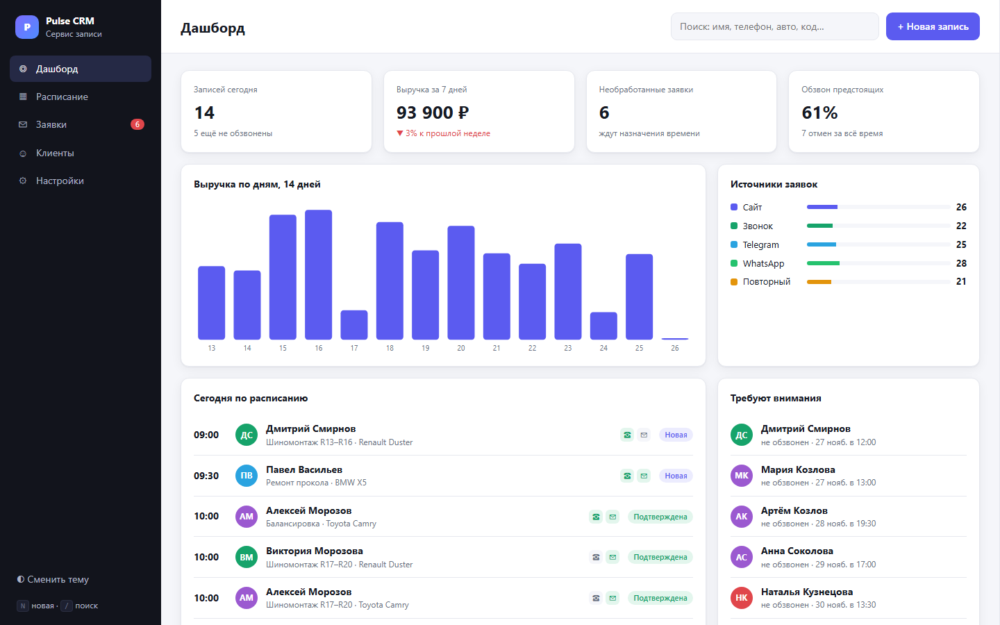
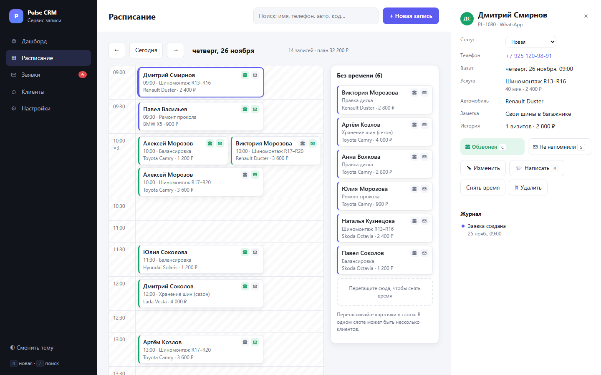
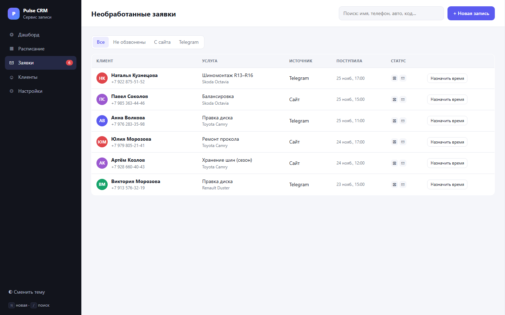
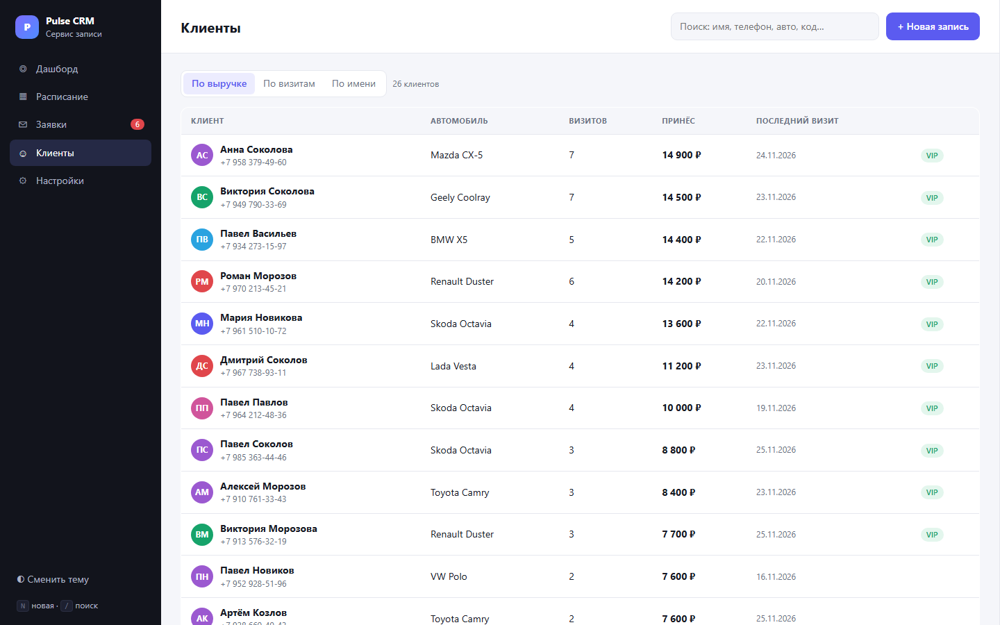
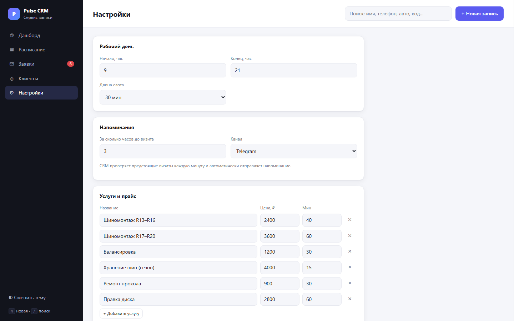
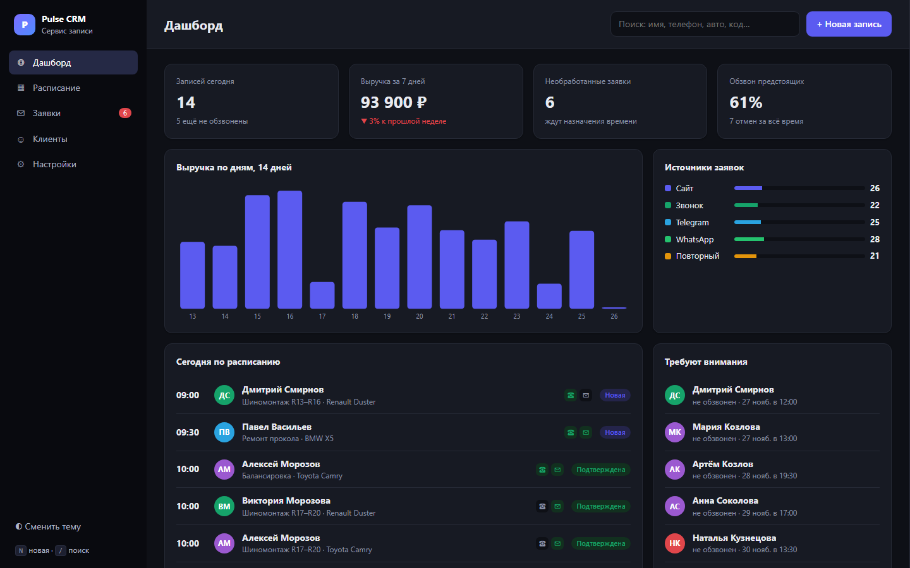

# Pulse CRM — демо CRM для сервиса записи

Демонстрационная CRM для бизнеса, который работает по записи (шиномонтаж, автосервис, салон, клиника).
Работает прямо в браузере, без сервера и установки — данные хранятся локально.

**Попробовать:** https://duryagin228777666-lab.github.io/pulse-crm-demo/



## Возможности

- **Дашборд** — записи на сегодня, выручка за неделю с динамикой, необработанные заявки, процент обзвона, график выручки за 14 дней, источники заявок, «требуют внимания»
- **Расписание дня** — сетка слотов (15/20/30/60 мин), несколько клиентов в одном слоте, перенос карточек мышью (drag & drop)
- **Необработанные заявки** — заявки без времени (с сайта, из Telegram), фильтры, назначение времени в один клик
- **База клиентов** — собирается автоматически по телефону: визиты, выручка с клиента, последний визит, метка VIP
- **Карточка записи** — статус, отметки «обзвонен» и «напоминание», журнал всех действий
- **Сообщения по шаблонам** — Telegram / WhatsApp / SMS с подстановкой имени, времени, услуги и цены
- **Автонапоминания** — за N часов до визита (в демо — симуляция)
- **Настройки** — рабочие часы, длина слота, прайс услуг, экспорт в CSV, сброс демо-данных
- **Горячие клавиши** — `N` новая запись, `/` поиск, `Enter` изменить, `C` обзвон, `S` напоминание, `M` написать, `Del` удалить
- **Светлая и тёмная тема**

## Скриншоты

| Расписание и карточка клиента | Необработанные заявки |
|---|---|
|  |  |
| **Клиенты** | **Настройки** |
|  |  |



## Запуск локально

```bash
python -m http.server 5180
# открыть http://localhost:5180
```

Разделы открываются по ссылке: `#dashboard`, `#schedule`, `#inbox`, `#clients`, `#settings`.

## Стек

Чистый HTML, CSS и JavaScript без зависимостей. Все имена и телефоны в демо-данных вымышленные.
